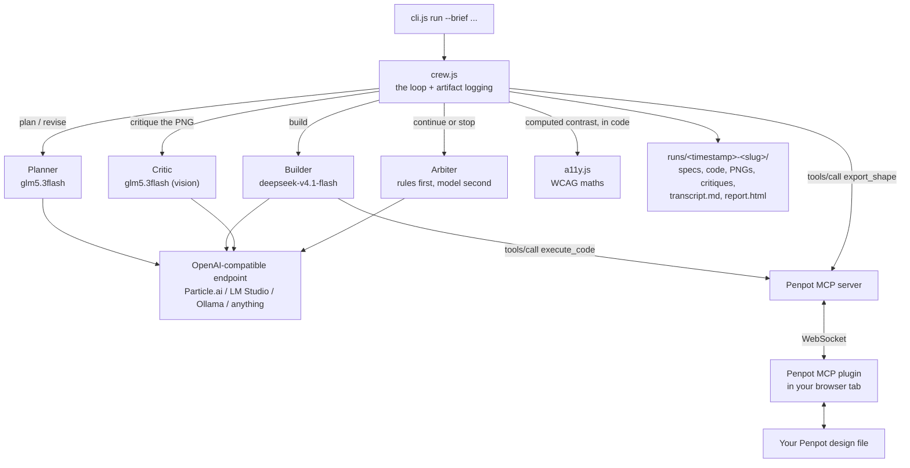

# Canvas Crew

**Four AI agents argue about one Penpot canvas until the design is good. The canvas is a projection of a spec; the exported PNG is the oracle.**

Not an image generator, and not a prompt box with a nicer font. A crew:

| Role | Job | Needs |
|---|---|---|
| **Planner** | brief -> structured specification; later revises the spec from findings | JSON mode |
| **Builder** | specification -> Penpot Plugin API JavaScript, executed on the live canvas | tool calling |
| **Critic** | looks at the exported PNG and judges the pixels | **vision** |
| **Arbiter** | decides whether another round is worth spending | JSON mode |

Plus one thing that is deliberately not a model: a **deterministic accessibility gate** that computes real WCAG contrast ratios in code. A model can be argued with. A ratio cannot.

---

## The core idea

Most "AI designs UI" tools iterate on **generated code**. That is why they break: a mid-tier model asked to patch imperative canvas code will quietly corrupt the file, and you have no way to see what changed.

Canvas Crew iterates on a **specification** instead:

```
brief ──► ScreenSpec ──► Plugin API JS ──► live canvas ──► PNG ──► critique
              ▲                                                        │
              └────────────────── revise (findings + computed facts) ──┘
```

Three reasons this is the right shape:

1. **A spec is diffable.** Every round writes `spec-diff.json`, so you can see exactly what the critic changed.
2. **A spec is revisable by a mid-tier model.** JSON in, JSON out, is far more reliable than surgical edits to imperative canvas code.
3. **The spec is where the accessibility maths lives**, so the gate has something deterministic to check.

The PNG is the oracle: the critic judges pixels, not intentions.

---

## Architecture



Zero runtime dependencies. Node 20+. Everything local except the inference call.

---

## Requirements

- **Node 20 or newer** (uses global `fetch` and `node:test`). No `npm install` needed: there are no dependencies.
- **Self-hosted Penpot 2.18+** with `enable-mcp` in `PENPOT_FLAGS`.
- **An OpenAI-compatible inference endpoint.** Particle.ai is the default. LM Studio, Ollama and Gemini all work.
- **A model with vision** for the critic. See the routing table below.

---

## Tech stack

There is no framework here and no build step. That is a deliberate choice: the whole thing should still run in two years with nothing installed.

| Layer | Choice | Why |
|---|---|---|
| Language | Plain JavaScript, ES modules | No transpiler, no bundler, no build step. Node runs the source directly. |
| Runtime | Node 20 or newer | Uses global `fetch` and the built-in `node:test` runner, so there is nothing to install. |
| Runtime dependencies | **None** | The MCP transport is JSON-RPC over HTTP, which `fetch` already does. |
| Dev dependencies | **None** | Tests use `node:test` and `node:assert`. |
| Design tool | Penpot 2.18+, self-hosted | Open source, stores designs as web structures, ships an MCP server. |
| Agent protocol | MCP Streamable HTTP | JSON-RPC posted to one endpoint, SSE replies, a session header. |
| Inference | Any OpenAI-compatible `/chat/completions` | Particle.ai by default, also LM Studio, Ollama, Gemini. |
| Accessibility | WCAG 2.2 maths, implemented directly | Contrast is arithmetic. It does not belong in a model. |
| Artifacts | JSON, PNG, one self-contained HTML file | No CSS framework, no client-side JS in the report. |
| Diagrams | Mermaid | Renders in GitHub and most editors. |

The full runtime surface is three things: `fetch`, `node:fs`, and `node:path`.

---

## The two Penpot steps people get wrong

These account for almost every "the agent says it has no Penpot access" report.

**1. The `userToken` is mandatory.** The official MCP container always runs `--multi-user`, so a tokenless URL fails on every file-touching call with `No userToken found in session context`. Get the ready-made URL from Penpot under **Your account -> Integrations -> MCP Server**; it already has the token appended:

```
http://localhost:9001/mcp/stream?userToken=<YOUR_MCP_KEY>
```

Use `localhost` when the crew runs on the same machine as Penpot, or the Penpot host's address when it does not.

**2. The plugin must be connected, in an open tab.** `high_level_overview` answers even with no plugin attached, so a successful call there proves nothing. In Penpot: open your design file, then **File -> MCP Server -> Connect**, and leave that tab open. This cannot be automated from the agent side.

---

## Quickstart

```bash
cp .env.example .env
# edit .env: paste PENPOT_MCP_URL (with the token) and PARTICLE_API_KEY

npm run check          # probe the MCP and measure what your models can actually do
npm run crew -- --brief "a pricing page for a local-first note taking app"
```

`npm run check` is not decoration. It measures each model's tool-calling, vision and JSON support with real calls, and refuses to start a run whose roles cannot be served. See the routing section for why that matters.

### Commands

```bash
node src/cli.js check                    # probe MCP + model capabilities, validate routing
node src/cli.js run --brief "..."        # run the crew
node src/cli.js run --brief "..." --rounds 2 --board "Landing"
node src/cli.js report <runDir>          # regenerate the HTML report
npm run demo                             # full offline run against mocks, no Penpot needed
npm test                                 # 32 unit + end-to-end tests
```

---

## What a run produces

Every round is on disk, so a run is reproducible, inspectable, and diagnosable. Nothing is hidden behind a spinner.

```
runs/2026-10-13T09-14-22-a-pricing-page/
├── brief.txt
├── spec.v1.json            # planner output
├── spec.v2.json            # after round 1 findings
├── spec.v3.json            # after round 2 findings
├── verdict.json            # accept | halt, the rule that decided it, and why
├── history.json            # the score trajectory
├── transcript.md           # the argument, in order, readable
├── report.html             # rounds side by side with scores and findings
├── round-1/
│   ├── code.js             # exactly the JavaScript the builder wrote
│   ├── audit.json          # computed contrast results
│   ├── board.png           # the export the critic looked at
│   ├── critique.json       # score, verdict, findings
│   └── spec-diff.json      # what the planner changed next
├── round-2/ ...
└── round-3/ ...
```

`report.html` is the artifact you show someone: rounds side by side, score trajectory, findings with severity, and the arbiter's reason for stopping. It is the timelapse of the argument.

---

## Model routing, measured not assumed

Different roles need different capabilities, and cheap models are not interchangeable. `npm run check` measures this. Measured across several runs on a Particle.ai key:

```
glm5.3flash            tools=yes  vision=yes  json=yes   (consistent)
deepseek-v4.1-flash    tools=yes  vision=intermittent  json=yes
```

`deepseek-v4.1-flash` answers image questions correctly on most attempts but returns empty content on some, so it is not the right model to hang the critic on. `glm5.3flash` was consistent across every probe, which is why the vision-dependent role is routed to it. This is exactly the kind of thing a static capability table gets wrong.

The default routing splits by strength rather than by hope:

```
CREW_PLANNER_MODEL=glm5.3flash         # JSON out, fast, low reasoning overhead
CREW_BUILDER_MODEL=deepseek-v4.1-flash # strongest at emitting imperative canvas code
CREW_CRITIC_MODEL=glm5.3flash          # must have vision
CREW_ARBITER_MODEL=glm5.3flash         # JSON out
```

**One endpoint behaviour worth knowing.** These endpoints serve reasoning models that emit a `reasoning_content` field, and **reasoning tokens are drawn from the same `max_tokens` budget**. A call with a small budget can spend everything on reasoning and return an empty `content` string, which looks exactly like a missing capability. This bit the capability probe itself during development: a probe at `max_tokens: 40` reported `vision=no` for a model that reads images fine.

Canvas Crew handles it two ways: `chat()` retries automatically with a larger budget when a response comes back empty **or truncated** (`finish_reason: "length"`), and the probes use generous budgets so they measure the model rather than the cap.

---

## Design decisions worth defending

**Why the arbiter is rules-first.** An LLM that "decides when it is good enough" is how you get a loop that never stops, or one that declares victory on a broken design. The decision is made in `applyRules()` in code, where it is auditable and unit-tested:

| Rule | Decision |
|---|---|
| round budget reached | `halt` |
| computed blockers outstanding | `revise` |
| score >= pass score, no blockers | `accept` |
| three rounds without improvement | `halt` |
| score fell by more than 2 | `halt` |

The model is consulted only for the reason and the focus list, and a failure there cannot stop the loop.

**Why computed findings cannot be argued away.** `normalizeCritique()` merges the accessibility findings into the critic's own and forces them to at least `major`. If a computed blocker exists, the verdict is `revise` no matter what the model claimed. A design with a 2.6:1 contrast ratio does not get accepted because a model felt good about it.

**Why there is a code guard.** The builder is the only role that mutates the user's design file, and the code it writes runs in the user's own plugin context, where a sandbox is not possible. `checkCodeSafety()` is a best-effort guard, not a sandbox: it rejects code that removes the page root, removes whole pages, closes the plugin, clears browser storage, or never mentions the target board name. A rejected attempt is retried once with the reason attached, and the failed code is still written to disk.

**Why the critic degrades honestly.** With no image available it does a spec-only review and says so in the report (`spec-only review` badge), rather than pretending it looked at the design.

**Why artifacts are written from a `finally` block.** A run that dies has to leave evidence behind. Transcript, verdict, history and report are all written even when the loop throws unexpectedly, so a crash produces a diagnosable run rather than a lost one. Ordered cheapest-first, so a failure in report generation still leaves the raw transcript on disk.

**Why every round persists its own verdict.** `report` regenerates `report.html` from disk alone. Per-round `verdict.json` means a regenerated report states the decision that was actually made, instead of inferring it. The reader also never links a PNG that is not present, and degrades to defaults on missing or corrupt JSON.

---

## How it works, in code

### 1. The loop

`src/crew.js` is the whole orchestration. One planning step, then a bounded loop:

```js
// Round 0: the planner turns the brief into a ScreenSpec
const planned = await planner.plan(brief);
spec = planned.spec;
writeFileSync(join(runDir, 'spec.v1.json'), JSON.stringify(spec, null, 2));

for (let round = 1; round <= config.maxRounds; round++) {
  const rendered = await builder.render(spec);          // spec -> canvas code -> canvas
  const exported = await canvas.exportShape(rendered.boardId, 'png');  // canvas -> PNG
  const audit = auditSpec(spec);                        // deterministic, no model
  const critique = await critic.critique({ brief, spec, audit, round, imageUrl });
  const verdict = await arbiter.decide({ history, round, audit });

  if (verdict.decision === DECISIONS.ACCEPT || verdict.decision === DECISIONS.HALT) break;

  spec = (await planner.revise({ spec, critique, audit, history })).spec;
}
```

Note what is *not* in the loop: no agent edits the canvas code. The spec is the shared artifact, and each round re-renders it from scratch. That is why a mid-tier model can drive this reliably.

### 2. The MCP client, and the failure detector that had to exist

The transport is deliberately boring: JSON-RPC posted to one endpoint, SSE frames parsed out of the reply, a session header echoed back.

```js
/** Parse a Streamable HTTP reply: SSE frames if present, else bare JSON. */
export function parsePayload(text) {
  const messages = [];
  let sawSse = false;
  for (const rawLine of String(text).split(/\r?\n/)) {
    const line = rawLine.trimStart();
    if (!line.startsWith('data:')) continue;
    sawSse = true;
    const payload = line.slice(5).trim();
    if (!payload || payload === '[DONE]') continue;
    try { messages.push(JSON.parse(payload)); } catch { /* partial frame */ }
  }
  if (!sawSse && String(text).trim()) {
    try { messages.push(JSON.parse(text)); } catch { /* not JSON */ }
  }
  return messages;
}
```

The part that took a live run to discover is that **Penpot reports tool failures without setting `isError`**, so checking the flag alone reads a failure as a success:

```js
const TOOL_FAILURE_PATTERNS = [
  /^Tool execution failed/i,
  /^Error:/i,
  /No Penpot instance connected/i,
  /frozen by the browser/i,
  /No userToken found in session context/i,
];

export function looksLikeToolFailure(text) {
  const t = String(text ?? '').trim();
  if (!t) return false;
  return TOOL_FAILURE_PATTERNS.some((re) => re.test(t));
}
```

The patterns are anchored on purpose. A *successful* `execute_code` can legitimately return data containing the word "Error", so an unanchored match would poison good results.

Because the plugin connection genuinely flaps, canvas calls go through a retry that only retries the two transient failures:

```js
export async function retryCanvas(fn, { attempts = 6, delayMs = 5000, onRetry } = {}) {
  let lastErr;
  for (let i = 0; i < attempts; i++) {
    try {
      return await fn();
    } catch (err) {
      lastErr = err;
      const transient = err?.frozen || err?.missing;
      if (!transient || i === attempts - 1) throw err;
      onRetry?.(err, i + 1);
      await sleep(delayMs * (i + 1));
    }
  }
  throw lastErr;
}
```

A genuinely broken call still fails fast. Only "the plugin is asleep" gets patience.

### 3. The gate that is not a model

Contrast is arithmetic, so it lives in code. `src/a11y.js` implements the WCAG 2.x relative luminance definition directly:

```js
export function relativeLuminance(hex) {
  const rgb = parseHex(hex);
  if (!rgb) return null;
  const [r, g, b] = rgb.map((v) => {
    const c = v / 255;
    return c <= 0.03928 ? c / 12.92 : Math.pow((c + 0.055) / 1.055, 2.4);
  });
  return 0.2126 * r + 0.7152 * g + 0.0722 * b;
}

export function contrastRatio(a, b) {
  const la = relativeLuminance(a);
  const lb = relativeLuminance(b);
  if (la === null || lb === null) return null;
  const light = Math.max(la, lb);
  const dark = Math.min(la, lb);
  return (light + 0.05) / (dark + 0.05);
}

/** WCAG "large text": >=24px, or >=18.66px when bold (>=700). */
export function isLargeText(fontSizePx, fontWeight = 400) {
  const size = Number(fontSizePx) || 0;
  const weight = Number(fontWeight) || 400;
  return size >= 24 || (size >= 18.66 && weight >= 700);
}
```

`auditSpec()` then walks every declared text block, resolves its colour token against the surface behind it, and returns findings with the measured ratio and the required threshold. Those findings are merged into the critic's findings and forced to at least `major`:

```js
// Computed accessibility failures are facts. Force them into the findings and
// never let them be downgraded to minor.
for (const f of audit?.findings ?? []) {
  const already = findings.some((x) => x.area === f.area && x.issue.slice(0, 40) === f.issue.slice(0, 40));
  if (already) continue;
  findings.push({
    severity: f.severity === 'blocker' ? 'blocker' : 'major',
    area: f.area,
    issue: f.issue,
    fix: f.fix,
  });
}
```

A design with a computed blocker cannot be accepted, whatever the model said.

### 4. The arbiter decides by rule, not by vibe

An LLM that decides when the design is "good enough" is how you get a loop that never stops, or one that declares victory on a broken screen. So the decision is a pure function, and the model is consulted only for the reason text:

```js
export function applyRules({ history, round, maxRounds, passScore }) {
  const latest = history[history.length - 1];
  if (!latest) return { decision: DECISIONS.REVISE, rule: 'no-history', reason: 'No rounds have run yet.' };

  // 1. Budget. Always respected, whatever the score says.
  if (round >= maxRounds) {
    return { decision: DECISIONS.HALT, rule: 'budget', reason: `Round budget of ${maxRounds} reached.` };
  }

  // 2. Computed blockers must be fixed before anything is accepted.
  if (latest.blockers > 0) {
    return { decision: DECISIONS.REVISE, rule: 'blockers', reason: `${latest.blockers} blocker(s) outstanding.` };
  }

  // 3. Good enough and clean.
  if (latest.score >= passScore) {
    return { decision: DECISIONS.ACCEPT, rule: 'pass-score', reason: `Score ${latest.score}/10 meets the bar.` };
  }

  // 4. Oscillation guard: three flat rounds means another round goes in circles.
  if (history.length >= 3) {
    const [a, b, c] = history.slice(-3).map((h) => h.score);
    if (c <= b && b <= a) {
      return { decision: DECISIONS.HALT, rule: 'no-improvement', reason: `Scores ${a} -> ${b} -> ${c}.` };
    }
  }
  // ...and a regression guard for a score that falls sharply
}
```

Every branch is unit tested, which is the point. You cannot unit test a model's opinion.

### 5. The critic, and why the system prompt is not optional

The critic is the only role that needs vision. It is also where a real bug lived: the vision call originally sent only a user message, so the model had no output contract and replied in markdown. The fix is one line, plus a re-ask:

```js
const useVision = Boolean(imageUrl) && canSee;

/** One attempt. `strict` appends a re-ask when the first reply was prose. */
const attempt = async (strict) => {
  const user = strict ? `${prompt}\n\n${STRICT_RETRY}` : prompt;
  if (useVision) {
    // The system prompt is essential here: it carries the JSON contract.
    const res = await client.vision({
      model,
      system: CRITIC_SYSTEM,
      prompt: user,
      imageUrl,
      maxTokens: 2000,
      temperature: 0.2,
    });
    return { text: res.text, usage: res.usage, visual: true };
  }
  // ...spec-only path, which says out loud that it could not see the render
};

let result = await attempt(false);
let parsed = extractJson(result.text);

if (parsed === undefined) {
  // One re-ask with the contract restated, then give up honestly.
  const retry = await attempt(true);
  result = retry;
  parsed = extractJson(retry.text);
}
```

And the rule that matters more than the retry: **an unparseable critique gets no score at all.**

```js
// No parsed response means no score. Never substitute a default.
const score = parsed ? clamp(Number(src.score), 1, 10, null) : null;
```

An invented `5/10` is worse than no score, because the loop then optimises against a number nobody produced while the transcript looks authoritative. Unparsed critiques halt the run with rule `critique-unparsed`.

### 6. The inference client, and the empty response trap

One endpoint behaviour cost real debugging time. These endpoints serve reasoning models, and `reasoning_content` tokens are drawn from the same `max_tokens` budget, so a small budget can return an empty `content` string. That looks exactly like a missing capability, and it made a capability probe report `vision=no` for a model that reads images fine.

```js
const choice = parsed?.choices?.[0];
const msg = choice?.message;
const empty = !contentOf(parsed) && !msg?.tool_calls?.length;
// A response cut off at the token ceiling is just as unusable as an
// empty one, and it is not a capability signal either. Retry bigger.
const truncated = choice?.finish_reason === 'length';
if (retryOnEmpty && (empty || truncated) && attempt < retries) {
  if (typeof body.max_tokens === 'number') {
    body = { ...body, max_tokens: Math.min(body.max_tokens * 3, 16_000) };
  }
  continue;
}
return parsed;
```

`npm run check` then measures each model's real tool-calling, vision and JSON support with live calls, and refuses to start a run whose roles cannot be served.

---

## Traps found by running this against real Penpot

Every one of these cost real debugging time.

1. **`high_level_overview` succeeding is a false positive.** It answers with no plugin attached. Only a file-touching call proves anything.
2. **A backgrounded Penpot tab gets frozen and the connection drops.** The MCP then rejects tasks with `The Penpot plugin tab has been frozen by the browser`, and later with `No Penpot instance connected for user token`. Pin the tab, and in Chrome add your Penpot site under *Settings -> Performance -> "Always keep these sites active"*. This is the single biggest obstacle to unattended runs, and it is why the connection is checked before a run rather than assumed.
3. **`width` and `height` are read-only.** Use `shape.resize(w, h)`. `x` and `y` are writable.
4. **A fresh Text shape is 1px wide.** Left that way the browser renders it one character per line and destroys the design, while the returned data still looks fine. Give text an explicit width, then `growType = 'auto-height'`.
5. **Hex colours must be uppercase.** Lowercase is unreliable.
6. **`fills` must be replaced, not mutated.**
7. **Page switching is async.** `openPage()` followed by a write in the same call writes to the previous page.
8. **Small `max_tokens` produces empty content** because of reasoning tokens (see above).
9. **A truncated JSON response is not a capability signal.** `finish_reason: "length"` means retry with a bigger budget.
10. **Models drift from the schema.** A planner asked for a flat object will sometimes return `{"specification": {...}}`. `normalizeSpec()` repairs what it can and the planner prompt now states the exact top-level keys.
11. **Penpot reports tool failures WITHOUT the `isError` flag.** The failure arrives as ordinary text content, so a client that checks only `result.isError` sees a success. This is the most dangerous trap here: during the first live run it made a dead plugin connection look like a working one. The build step reported success, `export_shape` returned no image, and the critic quietly fell back to reviewing the spec while the report looked healthy. Canvas Crew now detects failure from the content itself (`looksLikeToolFailure`) and classifies it into a typed error. There is a regression test for it.
12. **The connection flaps mid-run.** On a real run the plugin answered for the build step and was gone by the export step, then came back. Both `frozen` and `missing` failures are treated as transient and retried before a round is given up.
13. **A vision call with no system prompt returns prose, not JSON.** The critic's JSON contract lives in its system prompt. The vision path originally sent only a user message, so the model answered in markdown, the parse failed, and the critique was unusable. Both paths now send the system prompt, and a failed parse triggers one re-ask with the contract restated.
14. **A parse failure must never become a default score.** When the critique could not be parsed, the old code substituted a default `5/10`. That is worse than no score: the loop then optimises against a number nobody produced, and the transcript confidently reports a judgement that was never made. An unparsed critique now carries `score: null`, is marked `parsed: false`, and the crew halts with rule `critique-unparsed` rather than continuing on a fiction.
15. **The plugin dies when its tab is hidden.** Launching the crew from a terminal on the same machine pushes the Penpot window behind the terminal, the browser freezes the tab, and the plugin connection drops mid-run. Keep the Penpot window visible beside the terminal. The crew now proves the plugin is attached *before* spending a single model call, and waits about 75 seconds per call for you to click back.
16. **Reasoning tokens are drawn from the same budget as the answer.** This is the one that made the builder return nothing. Measured on a real 7-section spec with `deepseek-v4.1-flash`:

```
max_tokens 4000:   finish_reason=length   reasoning_tokens=16000   content=0 chars
max_tokens 16000:  finish_reason=stop     reasoning_tokens=9821    content=11742 chars
```

The model spent the entire budget thinking and wrote zero characters of code. The crew reported "Generated code is empty", which named the symptom and hid the cause. Builder budgets are now 16000 by default, the retry escalation goes to 48000, and a run that hits this reports the token accounting instead of a bare "empty". The raw reply and the usage are both written to the run directory.

17. **A planner that returns an identical spec wastes a whole round.** Re-rendering the same spec produces the same canvas and the same critique. When a revision produces zero changes the crew now stops with rule `no-spec-change` and says so, instead of spending a round to rediscover the same findings.

---

## When the plugin drops

This is the most common failure and it is never a bug in your setup.

```
  canvas not reachable (retry 1): No Penpot plugin is connected to this MCP session.
  - click into the Penpot tab to wake the plugin.
```

What to do:

1. **Keep the Penpot window visible**, beside your terminal rather than behind it. A hidden or fully occluded tab gets frozen by the browser.
2. In Chrome, add your Penpot site under **Settings -> Performance -> "Always keep these sites active"**.
3. If it still drops, raise the retry window in `.env`:

```
CREW_RETRY_ATTEMPTS=12
CREW_RETRY_DELAY_MS=5000
```

The crew retries only these two transient failures, so a genuinely broken run still fails fast rather than hanging.

---

## What the live runs actually did

### Run 1, before the fixes

A real run against a self-hosted Penpot 2.18 canvas, three rounds, on the brief "a landing page for DailyBuild.xyz":

```
Round 1  builder wrote 253 lines, executed on the canvas  |  gate: 11 blockers  |  critic 5/10
Round 2  builder wrote 267 lines, executed on the canvas  |  gate:  2 blockers  |  critic 4/10
Round 3  builder wrote 193 lines, executed on the canvas  |  gate:  0 failures  |  critic 7/10
Arbiter: HALT (budget)  scores 5 -> 4 -> 7
```

What worked: the builder wrote and executed real Plugin API JavaScript on a real canvas three times; the deterministic gate drove the contrast blockers from 11 to 0 across three real specs; the planner revised the spec twice, adding `accent-deep #4F46E5` to fix buttons whose labels were invisible at 1.00:1.

What did not: the export failed and the critic never saw a pixel, which is trap 11 above.

### Run 2, after the fixes

Three rounds on "a pricing page for a local-first note taking app":

```
Round 1  builder wrote 298 lines, rendered 211 KB PNG  |  critic 6/10 (saw the render)  |  2 blockers
Round 2  builder wrote 453 lines, rendered 206 KB PNG  |  critic 8/10 (saw the render)  |  1 blocker
Round 3  builder wrote 401 lines, rendered 205 KB PNG  |  critic 5/10 (saw the render)  |  0 blockers
Arbiter: HALT (budget)   scores 6 -> 8 -> 5
```

Every round exported a real ~205 KB render and every critique was a genuine vision review. One finding, which is a real rendering bug a human would also have to hunt for:

> The first nav link renders as 'atures'. The word 'Features' is clipped on its left edge, so the text frame is narrower than the string.

That is the project working as intended: the agents looked at the pixels and found something the specification never mentioned.

---

## Diagnostic scripts

Small tools, useful when something is not working. None of them write to your file except `inspect-file` which only reads.

```bash
node scripts/inspect-file.mjs     # read-only: what file, page and boards are currently open
node scripts/export-diagnose.mjs  # try every export_shape variant and print the raw blocks
node scripts/planner-smoke.mjs    # run the real planner prompt against each model
node scripts/probe-diagnose.mjs   # print raw probe responses, for capability oddities
node scripts/builder-diagnose.mjs # reproduce a builder call and print the token accounting
```

To wake a suspended Penpot tab without touching the mouse, including from another
machine over SSH:

```bash
osascript scripts/wake-penpot.applescript
ssh <penpot-host> 'osascript' < scripts/wake-penpot.applescript
```

## Forking and contributing

### Getting set up

```bash
git clone <your-fork-url> penpot-canvas-crew
cd penpot-canvas-crew
cp .env.example .env      # add your MCP URL and an inference key
npm test                  # 47 tests, no Penpot and no keys needed
npm run demo              # full offline run against mocks, writes a real report
```

There is nothing to install. If `npm test` and `npm run demo` pass, your environment is correct.

### Project layout

```
src/
  cli.js            command surface: check / run / report
  crew.js           the loop, artifact writing, connection retry
  mcp.js            MCP client, SSE parsing, failure detection and classification
  models.js         OpenAI-compatible client, capability probe, model routing
  spec.js           ScreenSpec schema, normalisation, diffing
  a11y.js           WCAG contrast maths and the deterministic gate
  prompts.js        every prompt, including the Plugin API trap list
  report.js         the HTML report, and reading a run back off disk
  roles/
    planner.js      brief -> spec, and spec revision
    builder.js      spec -> canvas code, plus the code safety guard
    critic.js       vision critique, and honest degradation
    arbiter.js      the rules, and the model consultation
test/
  mock-mcp.mjs      a fake Penpot MCP server with five failure modes
  mock-llm.mjs      a fake inference server with a scripted trajectory
  *.test.mjs        unit and end-to-end tests
scripts/            small diagnostic tools, see the section above
```

### Where to make a change

| You want to change | Edit |
|---|---|
| What the canvas code looks like | `src/prompts.js` (`builderSystem`) and `CANVAS_RULES` |
| How the design is structured | `src/spec.js` and `PLANNER_SYSTEM` |
| What counts as a blocker | `src/a11y.js` (`auditSpec`) |
| When the loop stops | `src/roles/arbiter.js` (`applyRules`), then add a test |
| How a role talks to a model | the matching file in `src/roles/` |
| The report's look | `src/report.js` |

### Adding a new role

Roles are plain factories, so a new one is a small, self-contained file:

```js
export function createResearcher({ client, model }) {
  return {
    name: 'researcher',
    model,
    async research({ brief }) {
      const raw = await client.text({ model, system: RESEARCH_SYSTEM, user: brief });
      return { notes: raw };
    },
  };
}
```

Wire it into `runCrew()`, then add a test with a canned response in `test/mock-llm.mjs`. The mock server dispatches on prompt text, so a new role needs one new branch there.

### House rules

1. **Every new decision needs a test.** The rules-based arbiter, the contrast gate and the code guard exist because they are testable. Keep it that way.
2. **Never let a failure be silent.** If something cannot be done, say so in the transcript and record it in the run directory. Silent degradation is the bug class this project has fought hardest.
3. **No dependencies.** If you reach for a package, explain why in the pull request. `fetch` and `node:fs` have covered everything so far.
4. **Comment the why, not the what.** The existing comments record traps that cost real debugging time. That is the house style.
5. **Report the measured value, not the hoped-for one.** If your change claims an improvement, put the before and after in the pull request.

### Feature ideas worth building

Roughly ordered by value against effort.

**Close to the current shape**

1. **Variant grid.** Generate N boards from one spec side by side, export a contact sheet, and let a human keep one. Turns a single shot into an explore step.
2. **PNG contact sheet.** Compose the round PNGs into one strip image so the timelapse is a single shareable file instead of a folder.
3. **Real token binding.** Write the spec palette into a real Penpot token set and export it as CSS variables plus a Tailwind config. That is the honest bridge from canvas to shipped code.
4. **Cost and token meter.** Count tokens per role, price the run, and print one line at the end. Useful the moment you run this on anything paid.
5. **Deterministic mode.** A fixed temperature and a seeded palette so two runs on the same brief are comparable, which is what makes evaluation possible.

**Bigger, still local**

6. **Screenshot to spec.** Paste an image of any UI and have a vision model produce a ScreenSpec, so the canvas becomes an editable reproduction rather than a picture. This is the inverse of the current direction and it is the most requested thing in this space.
7. **Multi-screen flows.** Generate a linked set of boards (onboarding, empty state, error state) with Penpot flows connecting them, then export a clickable prototype.
8. **Component extraction.** After a few screens, ask the agent to find repeated structures and promote them into real Penpot components, then re-render against them.
9. **Critic ensemble.** Run two critics on different models and require agreement before accepting. Disagreement becomes a signal rather than a coin flip.
10. **Resumable runs.** Checkpoint after each round and add `--resume <runDir>` so a dropped connection costs one round instead of the whole run.

**Platform**

11. **The headless bridge.** Pin a Chromium, load Penpot, connect the plugin automatically, and keep the MCP session alive. This removes the focused-tab requirement, which is the single biggest constraint on this project, and unlocks cron, CI and batch runs.
12. **Fleet mode.** Apply one spec, audit or token migration across many files with per-file before and after.
13. **A `.penpot` reader and writer for Node.** The community has asked for this repeatedly. It would let agents work on the declarative file format directly, with no browser in the loop at all.
14. **Watch mode.** Watch the spec directory and re-render the board whenever it changes, so the canvas becomes a live view of a file you edit in your editor.

---

## Known limits

- **The plugin connection is the weak link.** While the Penpot tab is unfocused the connection drops, so this is currently a supervised tool, not a cron job. A headless bridge (pinning a browser and keeping the plugin session alive) is the obvious next step and would unlock unattended and fleet-scale runs.
- **Penpot's MCP surface is essentially one tool**, `execute_code`. The model writes raw Plugin API JavaScript, so codegen quality varies a lot by model.
- **A round costs several model calls and roughly 1 to 3 minutes**, mostly the builder writing canvas code.
- **The critic's judgement is a model's judgement.** The computed gate is objective; the visual critique is not, and the report labels which is which.

## Non-goals

- No accounts, no database, no cloud service, no deployment story. It is a local tool.
- No image generation. The output is vector structure on a canvas.
- It does not edit existing designs in place. It owns one board, named by `CREW_BOARD_NAME`, and recreates it each round.

## Verified state

- `npm test`: **49 tests pass**, covering the contrast maths, spec repair, JSON extraction, the code guard, the arbiter's rules, the MCP transport, unflagged tool failures, unparsed critiques, token-exhausted builders, no-change revisions, report regeneration from disk, crash-safe artifact writing, and eight full offline end-to-end runs.
- `npm run demo`: produces a complete run and a `report.html` with no Penpot and no API key.
- `npm run check`: verified against a real self-hosted Penpot MCP server and real Particle.ai models.
- **A real three-round run against a live Penpot canvas with working exports**: 298 / 453 / 401 lines of Plugin API code executed, three ~205 KB renders exported, three vision critiques parsed, contrast blockers driven to 0 (61 pairs checked in the final round). See the run log above.